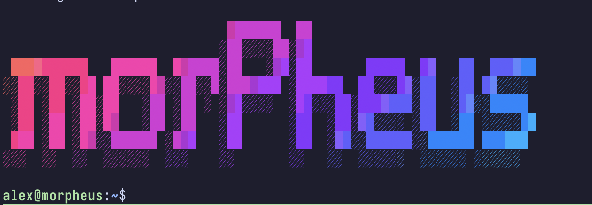

# Figurine Shell

This was inspired by Alex's [Youtube Video](https://youtu.be/GPQ6k2GR17I?si=aThvA-4suKPz0HfJ) on how to create a custom greeting message for your terminal. He also wrote an ansible role to automate the process, check it out [here](https://github.com/ironicbadger/ansible-role-figurine)

The script installs the Figurine package, which displays ASCII art text in your terminal. The script downloads the Figurine package, installs it, and configures it to display a greeting message when you log in to your shell.

> [!NOTE]
> The script detects your architecture and installs the matching Figurine build (`amd64`, `arm64`, or 32-bit `arm`).

## Prerequisites

- Linux OS: This script is designed for Linux operating systems.
- Root Access: The script requires root access to move files to system directories (`/usr/local/bin/` and `/etc/profile.d/`).
- curl or wget, and tar: Needed to download and unpack the Figurine package.

## Screenshots

[](./.github/assets/mux.png)

## Installation

Run with curl:

```bash
curl -fsSL https://raw.githubusercontent.com/alexraskin/figurine-shell/main/install.sh | sudo bash
```

Or with wget:

```bash
wget -qO- https://raw.githubusercontent.com/alexraskin/figurine-shell/main/install.sh | sudo bash
```

Prefer to inspect it first? Download, read, then run:

```bash
wget https://raw.githubusercontent.com/alexraskin/figurine-shell/main/install.sh
less install.sh
sudo bash install.sh
```

Restart your shell session to see the greeting message.

### Nix

Try it without installing:

```bash
nix run github:alexraskin/figurine-shell -- -f 3d.flf hello
```

On NixOS, add the flake input and enable the module:

```nix
{
  inputs.figurine-shell.url = "github:alexraskin/figurine-shell";

  outputs = { nixpkgs, figurine-shell, ... }: {
    nixosConfigurations.myhost = nixpkgs.lib.nixosSystem {
      modules = [
        figurine-shell.nixosModules.default
        { programs.figurine.enable = true; } # optional: programs.figurine.font = "3d.flf";
      ];
    };
  };
}
```

## Usage

After installation, your system host name will be displayed at login. You can customize the greeting message by editing the `/etc/profile.d/figurine.sh` script.

To display ASCII art text using Figurine, run the `figurine` command followed by the name of the art file. For example:

```bash

figurine -f "3d.flf" cat
```

This will display the ASCII text for the word cat. You can find more ASCII art files [here](https://github.com/arsham/figurine/tree/master/figurine/fonts).

## License

[MIT](https://choosealicense.com/licenses/mit/)

## Acknowledgements

[ironicbadger](https://github.com/ironicbadger)
[arsham](https://github.com/arsham/figurine)
